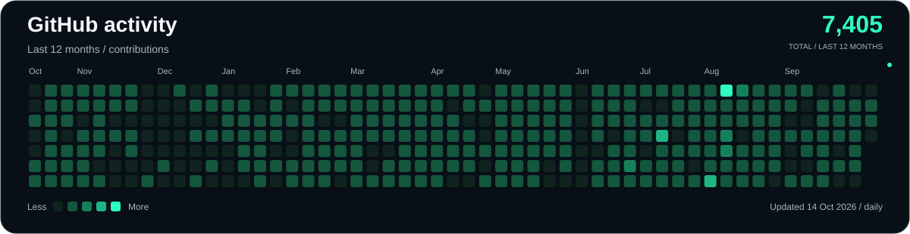

<picture>
  <source media="(prefers-reduced-motion: reduce) and (max-width: 540px)" srcset="assets/banner-mobile-still.png?v=2">
  <source media="(prefers-reduced-motion: reduce)" srcset="assets/banner-still.png?v=2">
  <source media="(max-width: 540px)" srcset="assets/banner-mobile.gif?v=2">
  
</picture>

# Hi, I'm Lakshay.

**Data Scientist**

AI researcher · Entrepreneur · Educator

Research, products, and education — connected by a goal of making AI useful, grounded, and accessible.

  
  
  
  

## About

I am a data scientist building AI at the intersection of Physics-Informed Neural Networks, 3D vision, agentic systems, product infrastructure, and AI education.

- Research, products, education, and open-source work are connected by the same goal: make AI systems useful, grounded, and accessible.
- My research focuses on Physics-Informed Neural Networks, 3D vision/generation, and physically grounded intelligence. I started my research journey at Harvard SEAS and currently work with [CLARITY Lab, IIT Jodhpur](https://home.iitj.ac.in/~hardikjain/ClarityLab.html).
- I am also building AI education products, developer tools, and applied AI systems across the [NextGenAISchool](https://www.nextgenaischool.in/) ecosystem.

## Selected work

A few things I'm building across research, communities, and the NextGenAISchool ecosystem.

<a href="https://lakshay-13.github.io/fren/">
  <picture>
    <source media="(prefers-reduced-motion: reduce) and (max-width: 540px)" srcset="assets/projects/fren-mobile-still.svg?v=2">
    <source media="(prefers-reduced-motion: reduce)" srcset="assets/projects/fren-still.svg?v=2">
    <source media="(max-width: 540px)" srcset="assets/projects/fren-mobile.svg?v=2">
    
  </picture>
</a>

<a href="https://pinnhub.nextgenaischool.in/">
  <picture>
    <source media="(prefers-reduced-motion: reduce) and (max-width: 540px)" srcset="assets/projects/pinnhub-mobile-still.svg?v=2">
    <source media="(prefers-reduced-motion: reduce)" srcset="assets/projects/pinnhub-still.svg?v=2">
    <source media="(max-width: 540px)" srcset="assets/projects/pinnhub-mobile.svg?v=2">
    
  </picture>
</a>

<a href="https://artgridx.nextgenaischool.in/">
  <picture>
    <source media="(prefers-reduced-motion: reduce) and (max-width: 540px)" srcset="assets/projects/artgridx-mobile-still.svg?v=2">
    <source media="(prefers-reduced-motion: reduce)" srcset="assets/projects/artgridx-still.svg?v=2">
    <source media="(max-width: 540px)" srcset="assets/projects/artgridx-mobile.svg?v=2">
    
  </picture>
</a>

<a href="https://lakshay-13.github.io/notifyme/">
  <picture>
    <source media="(prefers-reduced-motion: reduce) and (max-width: 540px)" srcset="assets/projects/notifyme-mobile-still.svg?v=2">
    <source media="(prefers-reduced-motion: reduce)" srcset="assets/projects/notifyme-still.svg?v=2">
    <source media="(max-width: 540px)" srcset="assets/projects/notifyme-mobile.svg?v=2">
    
  </picture>
</a>

<a href="https://lakshay-13.github.io/host/">
  <picture>
    <source media="(prefers-reduced-motion: reduce) and (max-width: 540px)" srcset="assets/projects/host-mobile-still.svg?v=2">
    <source media="(prefers-reduced-motion: reduce)" srcset="assets/projects/host-still.svg?v=2">
    <source media="(max-width: 540px)" srcset="assets/projects/host-mobile.svg?v=2">
    
  </picture>
</a>

<a href="https://lakshay-13.github.io/rl-pinn/">
  <picture>
    <source media="(prefers-reduced-motion: reduce) and (max-width: 540px)" srcset="assets/projects/rlpinn-mobile-still.svg?v=2">
    <source media="(prefers-reduced-motion: reduce)" srcset="assets/projects/rlpinn-still.svg?v=2">
    <source media="(max-width: 540px)" srcset="assets/projects/rlpinn-mobile.svg?v=2">
    
  </picture>
</a>

<a href="https://tree.nextgenaischool.in/">
  <picture>
    <source media="(prefers-reduced-motion: reduce) and (max-width: 540px)" srcset="assets/projects/tree-mobile-still.svg?v=2">
    <source media="(prefers-reduced-motion: reduce)" srcset="assets/projects/tree-still.svg?v=2">
    <source media="(max-width: 540px)" srcset="assets/projects/tree-mobile.svg?v=2">
    
  </picture>
</a>

<a href="https://lakshay-13.github.io/zinging/">
  <picture>
    <source media="(prefers-reduced-motion: reduce) and (max-width: 540px)" srcset="assets/projects/zinging-mobile-still.svg?v=2">
    <source media="(prefers-reduced-motion: reduce)" srcset="assets/projects/zinging-still.svg?v=2">
    <source media="(max-width: 540px)" srcset="assets/projects/zinging-mobile.svg?v=2">
    
  </picture>
</a>

<strong>Explore all 21 projects</strong> — products, research, experiments, and repositories

The portfolio currently features **21 projects**, ordered with deployed products and active platforms first, followed by research, experiments, and repositories.

1. **[FREN Bot](https://lakshay-13.github.io/fren/)** — AI-powered community platform with games, moderation, social loops, AI utilities, and premium workflows.
2. **[PINN Hub](https://pinnhub.nextgenaischool.in/)** — Deployed research hub for Physics-Informed Neural Networks and neural differential-equation experiments.
3. **[ArtGridX](https://artgridx.nextgenaischool.in/)** — Portfolio publishing for artists, studios, and creative independents.
4. **[NotifyMe](https://lakshay-13.github.io/notifyme/)** — Android notification platform with profile-labelled alerts, local messaging, history sync, callbacks, and portable conversation data.
5. **[Host](https://lakshay-13.github.io/host/)** — Developer-first hosting platform for deploying projects with simple workflows and production-ready defaults.
6. **[RL-PINNs](https://lakshay-13.github.io/rl-pinn/)** — Reinforcement-learning framework direction for adaptive Physics-Informed Neural Network training control loops.
7. **SlideNext** — Next-generation presentation platform for AI-assisted decks, education workflows, and structured storytelling. *(Preview soon.)*
8. **[Watermark Studio](https://watermark.nextgenaischool.in/)** — Protected publishing workspace for image watermarking, branded exports, document protection, and controlled content distribution.
9. **[Fren Shop](https://www.nextgenaischool.in/fren)** — Official shop and support hub for FREN with premium drops, updates, and community goodies.
10. **[Tree](https://tree.nextgenaischool.in/)** — Modern identity and profile platform direction expressed through interactive tree systems and profile surfaces.
11. **[Zinging](https://lakshay-13.github.io/zinging/)** — Self-evolving AI bot and agent ecosystem designed for adaptive communities, automation, and agentic utilities.
12. **[URL Extractor](https://url.nextgenaischool.in/)** — Lightweight extraction tool designed to surface links quickly from captured and generated content.
13. **[RAGS-Demo](https://github.com/Lakshay-13/RAGS-Demo)** — Retrieval-Augmented Generation demo for enhanced information retrieval and response generation.
14. **[Classifying Periodic Variable Stars](https://github.com/Lakshay-13/Classifying-Periodic-Variable-Stars)** — Time-series ML project classifying four classes of periodic variable stars.
15. **[Automated Notes Maker](https://github.com/Lakshay-13/Automated-Notes-Maker-from-Audio-Recordings)** — Tooling for automated note creation from audio recordings.
16. **[Customer Relationship Prediction](https://github.com/Lakshay-13/Customer-Relationship-Prediction)** — Predicting churn, appetency, and up-selling behavior from marketing databases.
17. **[Music Genre Prediction](https://github.com/Lakshay-13/Music-Genre-Prediction)** — Predicting music genres using data analysis and ML techniques.
18. **[Code Image Generator](https://github.com/Lakshay-13/Code-Image-Generator)** — Python-based tool for generating images from code snippets.
19. **[Morph Images](https://github.com/Lakshay-13/Morph-Images)** — Image morphing project focused on computer vision techniques.
20. **[Transcribe App](https://github.com/Lakshay-13/transcribe-app)** — Application for automatic speech-to-text transcription workflows.
21. **[Grid](https://github.com/Lakshay-13/grid)** — Framework direction for distributed computing and resource management.

## Across the ecosystem

  

## Activity

<picture>
  <source media="(prefers-reduced-motion: reduce) and (max-width: 540px)" srcset="assets/activity-mobile-still.svg">
  <source media="(prefers-reduced-motion: reduce)" srcset="assets/activity-still.svg">
  <source media="(max-width: 540px)" srcset="assets/activity-mobile.svg">
  
</picture>

Recent public activity

<!-- ACTIVITY:START -->
- Pushed code to [Lakshay-13/rl-pinn](https://github.com/Lakshay-13/rl-pinn) · `25 Sep 2026`
- Pushed code to [Lakshay-13/LPINNs](https://github.com/Lakshay-13/LPINNs) · `25 Sep 2026`
- Made a repository public: [Lakshay-13/LPINNs](https://github.com/Lakshay-13/LPINNs) · `04 Jul 2026`
- Made a repository public: [Lakshay-13/rl-pinn](https://github.com/Lakshay-13/rl-pinn) · `10 Feb 2026`

Updated 13 Oct 2026 · refreshed daily from GitHub public events. Private activity is not listed.
<!-- ACTIVITY:END -->

## Experience

<picture>
  <source media="(prefers-reduced-motion: reduce) and (max-width: 540px)" srcset="assets/experience-mobile-still.svg">
  <source media="(prefers-reduced-motion: reduce)" srcset="assets/experience-still.svg">
  <source media="(max-width: 540px)" srcset="assets/experience-mobile.svg">
  
</picture>

Text version

- **CEO** at [NextGenAISchool](https://www.nextgenaischool.in/) `(05/2026 - Present)`
- **Researcher** at CLARITY Lab, IIT Jodhpur `(06/2026 - Present)`
- **Project Associate** at IIT Jodhpur `(12/2025 - 05/2026)`
- **Freelancer** at Independent `(05/2025 - 11/2025)`
- **R&D Consultant** at System 3 `(01/2024 - 05/2025)`
- **Research Fellow (Computer Science)** at Harvard SEAS `(05/2024 - 07/2024)`
- **Researcher** at StellarDNN `(01/2023 - 08/2024)`
- **Learning Experience Supervisor + Analytics Consultant** at Univ.AI `(05/2022 - 12/2023)`
- **Big Data Analytics & Data Science Intern** at Appinventiv `(02/2022 - 06/2022)`
- **Big Data Analytics & Data Science Intern** at Jio `(08/2021 - 02/2022)`
- **Big Data Analytics & Data Science Intern** at Havells India Ltd `(01/2021 - 07/2021)`

## Toolkit

<picture>
  <source media="(prefers-reduced-motion: reduce) and (max-width: 540px)" srcset="assets/toolkit-mobile-still.svg">
  <source media="(prefers-reduced-motion: reduce)" srcset="assets/toolkit-still.svg">
  <source media="(max-width: 540px)" srcset="assets/toolkit-mobile.svg">
  
</picture>

Text version

- **AI & Machine Learning:** PINNs, Neural Differential Equations, 3D Vision, 3D Generative Modeling, Computer Vision, Generative AI, LLMs, RAG, Agentic LLM Systems, Multi-Agent Workflows, Reinforcement Learning
- **Languages & Frameworks:** Python, TypeScript, Kotlin, SQL, PyTorch, TensorFlow, CUDA, Next.js, React, Jetpack Compose
- **LLM & Data Stack:** LangChain, LangGraph, OpenAI API, Google GenAI/Gemini API, Ollama, vLLM, Hugging Face, NumPy, Pandas, Hive, Hadoop, Spark, EDA, Data Visualization
- **Product & Backend:** FastAPI, Express.js, PostgreSQL, Redis, Docker, Linux, S3-Compatible Storage, Firebase/FCM
- **Developer Tools:** Git, GitHub, GitHub Actions, API Design, Production Deployments, Observability

## Education

<picture>
  <source media="(prefers-reduced-motion: reduce) and (max-width: 540px)" srcset="assets/education-mobile-still.svg">
  <source media="(prefers-reduced-motion: reduce)" srcset="assets/education-still.svg">
  <source media="(max-width: 540px)" srcset="assets/education-mobile.svg">
  
</picture>

Text version

- **Master of Technology (Artificial Intelligence)**, IIT Jodhpur `(01/2025 - Present)`
- **Bachelor of Technology (Computer Science Engineering)**, Maharaja Agrasen Institute of Technology `(08/2018 - 06/2022, 8.6 CGPA)`

## Connect

- **Email:** [lakshaychawla13@gmail.com](mailto:lakshaychawla13@gmail.com)
- **Phone:** [+91 9811096411](tel:+919811096411)
- **GitHub:** [github.com/Lakshay-13](https://github.com/Lakshay-13)
- **LinkedIn:** [linkedin.com/in/lakshaychawla13](https://www.linkedin.com/in/lakshaychawla13)
- **Portfolio:** [lakshay-13.github.io](https://lakshay-13.github.io)
- **Resume:** [View Resume](https://drive.google.com/file/d/18PgQ_zQ0XuA0Eyh0GeSW_2LWA-vjwEkp/view?usp=sharing)
